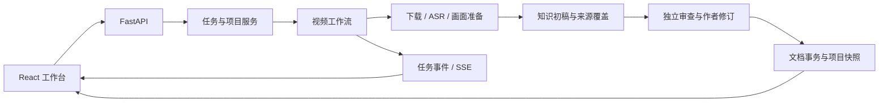

# 架构与扩展入口

## 一条视频如何成为知识文档

后端是单个 Python 服务。任务运行状态与工作线程在进程内，SQLite 保存项目和消息，媒体及阶段工件保存在本地目录。不要用多 worker 或多进程同时编辑同一项目来扩展并发。

普通对话沿 `messages API → ChatAgent → 工具调度 → 结果回灌 → 保存回复` 运行；视频整理沿 `services.processing → Pipeline → 媒体准备 → 草稿/覆盖 → 审核 → 正式保存` 运行。任务失败不会把未通过的候选伪装为正式输出。

## 后端模块

| 目录 | 主要入口与责任 |
|---|---|
| `backend/app/api/` | `server.py` 装配路由；`messages.py`、`videos.py`、`tasks.py` 等承接界面请求 |
| `backend/app/services/` | `processing.py` 提交任务；`documents.py` 保存知识；`recovery.py` 校验恢复输入；`project_files.py` 管理本地快照 |
| `backend/app/agent/conversation/` | `chat.py` 对话工具循环，`intent.py` 解析整理意图，`conversation_memory.py` 管理历史和摘要 |
| `backend/app/agent/runtime/` | `llm.py`、`http_transport.py`、上下文预算、压缩、心跳和公开进度 |
| `backend/app/agent/knowledge/` | 草稿、结构契约、来源支持、覆盖检查、融合和改写 |
| `backend/app/agent/review/` | 审查投影、工具权限、审查报告和作者修订循环 |
| `backend/app/agent/media/` | 媒体预检、音画准备、图像分析、插图和受校验的缓存复用 |
| `backend/app/agent/tooling/` | 工具参数协议、只读知识查询、调度注册和安全网页取证 |
| `backend/app/agent/workflow/` | `pipeline.py` 编排全流程，`formal_receipts.py` 绑定正式输出回执 |
| `backend/app/worker/` | 执行下载、转写、抽帧、媒体检查和 HTML 渲染 |
| `backend/app/sources/` | Bilibili 元信息与媒体接口适配 |

工具 Schema 描述模型可以请求什么，dispatcher 决定实际允许执行什么。修改协议时需同步执行权限、参数校验和工具结果处理。审查者、来源作者和聊天助手的上下文与工具集合不同。

## 前端与原生外壳

`frontend/src/app/App.tsx` 协调工作区；各功能放在 `features/` 下。`features/tasks/useTaskEvents.ts` 订阅 SSE，`ProjectTasks.tsx` 展示历史与恢复入口，`KnowledgePanel.tsx` 负责知识阅读，`VideoPlayer.tsx` 负责媒体状态和播放。

macOS 外壳由 `desktop/main.swift` 启动和关闭本机 Python 服务，提供目录/媒体选择、Finder 与 Keychain 桥。`backend/app/desktop_runner.py` 使用动态本机端口；普通 Web 入口保持为 `app.api.server:app`。

## 从哪里开始修改

- 调整界面：从对应 `features/` 目录进入，跨功能协调在 `app/`。
- 接入模型：阅读 `agent/runtime/llm.py`、`http_transport.py` 和 `model_limits.py`，确认供应商的工具、结构化输出、上下文与输出限制。
- 调整知识结构：同时检查 `knowledge/document_contract.py`、生成 Schema、渲染器和前端类型。
- 增加输入来源：将平台请求放 `sources/`，媒体校验放 `worker/`，任务提交与保存继续通过现有服务。
- 修改生成或恢复：先阅读 `services/recovery_versions.py`，保持候选身份与来源哈希校验；不要通过删除门禁让旧候选被当成新结果。

数据库与项目文件快照分别保存。单次界面成功、模型返回成功或结构验证通过，均不能单独证明视频内容准确或所有资料已完整落盘。
